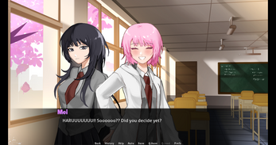
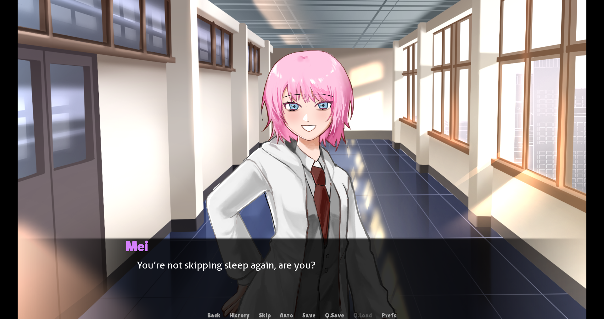
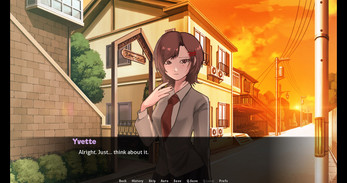
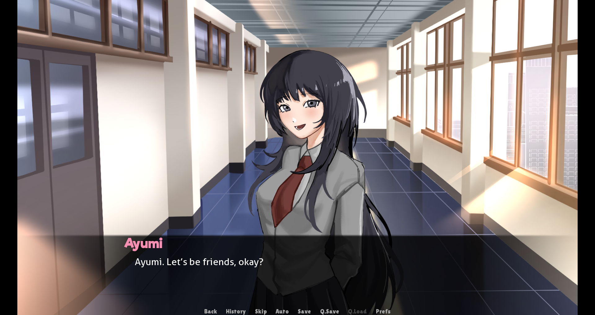

# 🔄 REstart

> A psychological mystery & romance visual novel built with **Ren'Py**.

---

## 📖 Overview

**REstart** follows Haru, a high school student caught between ordinary school life and surreal, unsettling glitches in reality. As familiar conversations loop and memories blur, encounters with his classmates reveal hidden fragments, strange occurrences, and an unraveling world.

Can you distinguish reality from the simulation before everything restarts?

---

## 📸 Screenshots & Previews

<div align="center">

| Classroom Moments | Hallway Encounter |
| :---: | :---: |
|  |  |

| Sunset Walk with Yvette | Meeting Ayumi |
| :---: | :---: |
|  |  |

</div>

---

## 👥 Characters

- **Haru (Protagonist)**: Quiet and observant, dealing with strange bouts of dejavu, headaches, and fractured perceptions.
- **Mei**: Cheerful, teasing, and energetic. Always keeping an eye on Haru.
- **Yvette**: Thoughtful and gentle, offering moments of peace amidst growing disorientation.
- **Ayumi**: An enigmatic student connected to anomalous glitch phenomena and hidden truths behind the world.

---

## ✨ Features

- **Branching Narrative**: Meaningful dialogue choices leading to multiple distinct routes and endings.
- **Atmospheric Storytelling**: Seamlessly transitions from lighthearted romance to psychological horror and glitch aesthetic.
- **Custom Art & Soundtracks**: Original character sprites, expressive expressions, atmospheric backgrounds, and emotive BGM.
- **Persistent Unlocks**: Discover hidden story fragments across multiple playthroughs.

---

## 🚀 Getting Started

### Prerequisites
- Windows / macOS / Linux
- [Ren'Py Engine](https://www.renpy.org/) (version 7.4+ or 8+) if editing or building from source.

### Running the Game
1. Download or clone this repository:
   ```bash
   git clone https://github.com/AdysonReales/RESTART.git
   ```
2. Launch the executable:
   - On Windows: Run `REstart-1.0-pc/REstart.exe`
   - On Linux/Mac: Launch `REstart-1.0-pc/REstart.sh` or open the project in the Ren'Py Launcher.

---

## 🛠️ Built With

- **Engine**: [Ren'Py Visual Novel Engine](https://www.renpy.org/)
- **Scripting**: Python & Ren'Py Script (`.rpy`)
- **Distribution Tools**: Butler / Itch.io
